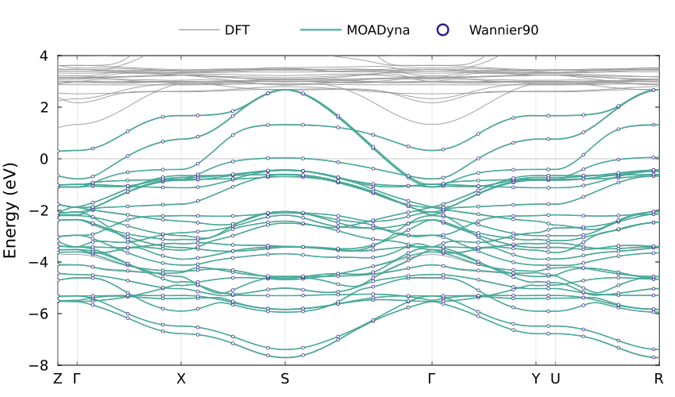
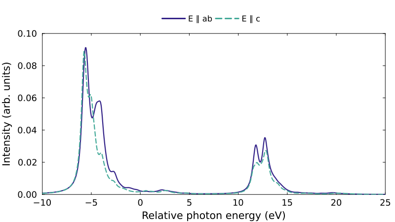

# Interfacing with Wannier90

```@meta
CurrentModule = MOADyna
```

This tutorial shows how to import a Wannier90 Hamiltonian, inspect its hoppings,
compare its bands with DFT, and construct an interacting cluster for spectroscopy.
The worked example uses the tetragonal La₃Ni₂O₇ structure and DFT inputs
associated with [Chen et al., *Nature Communications* **15**, 9597
(2024)](https://doi.org/10.1038/s41467-024-53863-5).

We construct two coupled Ni–O octahedra and calculate their Ni L-edge absorption.
The hoppings and crystal-field splittings come directly from DFT. The interaction
strengths and charge-transfer energy are separate model inputs. The same package
functions can be used with other Wannier models; the material-specific orbital
assignments and interaction choices are made explicitly below.

## Input files and scripts

The inputs describe a 31-spatial-orbital Wannier model of tetragonal
La₃Ni₂O₇: five d orbitals on each of two Ni atoms and three p orbitals on each
of seven O atoms in the primitive cell. They contain the one-electron
Hamiltonian and its crystal geometry. The Coulomb interactions, spin-orbit
coupling, electron count, and charge-transfer energy are set later in this
tutorial.

[Download the Wannier and DFT inputs](https://github.com/CorrelatedSpectra/MOADyna.jl/releases/download/v0.3.5/la3ni2o7-wannier.tar.gz)
(1.62 MiB) and unpack them:

```sh
tar -xzf la3ni2o7-wannier.tar.gz
```

The archive separates the Hamiltonian and geometry from the band data used to
check the interpolation:

| File | Contents | Used for |
|:-----|:---------|:---------|
| `model_hr.dat` | Real-space hopping matrices between the 31 Wannier orbitals, indexed by lattice translation, with degeneracy weights. Energies are in eV. | Constructing the tight-binding Hamiltonian for both bands and clusters. |
| `model.win` | Wannier90 input: primitive lattice vectors, atomic positions, k mesh, and the band-path endpoints and sampling settings. | Reading the geometry and interpolation settings; defining the stored Wannier band path. |
| `geometry.toml` | Unwrapped fractional Wannier centres, the orbital-to-atom assignment, and the source d-orbital order. This is a companion prepared for this dataset. | Matching the hopping table to the atoms when importing this model and selecting a cluster. |
| `model_band.dat` | Band energies interpolated by Wannier90 along its own k path. | Checking that MOADyna reproduces the stored Wannier bands. |
| `dft.spaghetti_ene` | Original WIEN2k DFT band energies and printed k coordinates. | Overlaying the original DFT bands. |
| `dft.klist_band` | Exact DFT k points as rational coordinates in the conventional reciprocal cell, with symmetry-point labels. | Evaluating MOADyna bands at the same points as the DFT calculation. |
| `model.struct` | Matching WIEN2k crystal structure, including the conventional-cell lattice parameters. | Converting the DFT k path to the primitive reciprocal coordinates used by the Wannier model. |
| `model_centres.xyz` | Wannier centres wrapped into the home cell, in Cartesian coordinates. | Inspecting the source centres; the scripts use the unwrapped centres in `geometry.toml`. |
| `model.inwf` | WIEN2Wannier atomic projection definitions and their orbital order. | Checking the orbital identities recorded in `geometry.toml`; the scripts do not read it. |
| `README.md` | Dataset provenance and coordinate conventions. | Understanding the input calculation. |
| `SHA256SUMS` | Checksums of the data files. | Checking the downloaded files. |

For **cluster construction and XAS**, only `model_hr.dat`, `model.win`, and
`geometry.toml` are read. The band files and `model.struct` can be omitted.
These same three files also suffice to calculate new tight-binding bands on a
chosen k path. Add `model_band.dat` to compare against Wannier90, and
`dft.spaghetti_ene`, `dft.klist_band`, and `model.struct` to reproduce the DFT
overlay below. The data is distributed separately from the package source.

The complete scripts are in
[`examples/la3ni2o7`](https://github.com/CorrelatedSpectra/MOADyna.jl/tree/main/examples/la3ni2o7).
From a MOADyna checkout, calculate XAS with:

```sh
julia --project=. --threads=8 examples/la3ni2o7/xas.jl la3ni2o7-wannier results
```

The two plotting scripts require Plots in the active environment. They can be
run independently:

```sh
julia --project=. --threads=4 examples/la3ni2o7/bands.jl la3ni2o7-wannier results
julia --project=. examples/la3ni2o7/plot_xas.jl results
```

`bands.jl` calculates and plots the band comparison. `plot_xas.jl` reads the
saved XAS results without repeating the spectroscopy calculation. The shared
model construction is in `model.jl`; its main steps are shown below.

The band calculation is small. The full interacting cluster has 658,008 ground-sector
determinants and 548,340 core-excited determinants; allow several GB of memory
for its sparse matrices and Krylov vectors.

## Read the Wannier model and structure

[`read_wannier90`](@ref) is the package function that imports the hopping table
and its companion files. For this dataset, we first read the orbital identities
and unwrapped Wannier centres from `geometry.toml`, then pass those centres to
the importer:

```julia
using MOADyna
using LinearAlgebra
using TOML

datadir = "la3ni2o7-wannier"
geometry = TOML.parsefile(joinpath(datadir, "geometry.toml"))
centres = reduce(hcat, geometry["centres_fractional"])
orbital_atoms = geometry["orbital_atoms"]
seed = joinpath(datadir, "model")
model = read_wannier90(seed; centres, interpolation=:ws)
```

`centres` has one fractional-coordinate column per Wannier orbital.
`orbital_atoms[i]` identifies the atom associated with orbital `i`, using the
atom order in `model.win`. `interpolation=:ws` reconstructs the centre-dependent
Wigner–Seitz shifts from the lattice, k mesh, and Wannier centres. The returned
model contains the effective hopping blocks ready for bands or cluster extraction:

```julia
model
```

```text
TightBindingModel(31 orbitals, 565 translations, 3 dimensions)
```

Inspect the dimensions and geometry:

```julia
A = model.lattice
atoms = model.metadata[:atoms].positions
size(model), size(atoms)
```

```text
((31, 31), (3, 12))
```

```julia
round.(A; digits=4)
```

```text
3×3 Matrix{Float64}:
 -1.912    1.912     1.912
  1.912   -1.912     1.912
 10.2015  10.2015  -10.2015
```

The columns of `A` are the primitive lattice vectors in Å. The columns of
`atoms` are Cartesian nuclear positions in Å. For example, the two Ni atoms are:

```julia
round.(atoms[:, 4:5]; digits=4)
```

```text
3×2 Matrix{Float64}:
  0.0      0.0
  0.0      0.0
 12.1663   8.2367
```

The structure and the WIEN2Wannier projection definitions give this assignment:

| Atoms in `model.win` | Species | Wannier orbitals |
|:--------------------|:--------|:-----------------|
| `1:3` | La | None in this model |
| `4` | Ni A | `1:5` |
| `5` | Ni B | `6:10` |
| `6:12` | O | `11:31`, three orbitals per atom |

There are twelve atoms in the primitive structure but only nine carry orbitals
in this Wannier model. The importer preserves the input's numeric atom labels
as strings; it does not infer the species or orbital character from them.
For another dataset, establish this assignment from its projection definitions
before selecting a cluster.

The centre file wraps Wannier centres into the home cell. The archive therefore
also supplies their unwrapped representatives in `geometry.toml`, which
we passed explicitly to `read_wannier90`. These representatives
must agree with the translation indices in the hopping table. Wannier centres
can be displaced from nuclei; atomic positions select the fragment, while the
orbital map and cell representatives identify its Hamiltonian entries.

In the example's `model.jl`, the reading lines above are wrapped in
`load_wannier(datadir)`, returning `(model, orbital_atoms)`. `load_wannier` is
a helper defined by this example; `read_wannier90` is part of MOADyna.
The code blocks on this page can be followed directly without loading that helper.

For your own Wannier90 calculation, `read_wannier90` also accepts the full
Hamiltonian filename or a directory containing one model. Keep the available
companion files together under the same seedname:

| Input | Information used by the importer |
|:------|:--------------------------------|
| `seed_hr.dat` or `seed_tb.dat` | Real-space Hamiltonian. The combined `_tb.dat` format also supplies lattice vectors and Wannier centres. |
| `seed.win` | Lattice, atom positions, k mesh, and declared interpolation settings. |
| `seed.wout` | Final Wannier centres and version information. |
| `seed_wsvec.dat` | Pair-dependent Wigner–Seitz translations, when written by Wannier90. |
| `seed_centres.xyz` | Wannier centres, when their cell representatives are established by the companion input. |

The default `interpolation=:auto` uses the available source declarations.
A bare `_hr.dat` does not identify its interpolation convention: use
`:plain` for the ordinary degeneracy-weighted Fourier sum or `:ws` for
centre-dependent Wigner–Seitz interpolation, according to the generating
calculation. The reader needs `_wsvec.dat`, or enough geometry and mesh
information to reconstruct its shifts, for the latter. In this example the
shifts are reconstructed; `model.metadata[:interpolation]` reports
`:reconstructed`.

## Inspect the hopping model

The returned [`TightBindingModel`](@ref) stores matrices with the convention

```math
t_{ij}(R)=\langle 0,i|h|R,j\rangle.
```

`R` is an integer translation in the primitive lattice. The row orbital is in
the reference cell and the column orbital is in cell `R`. Degeneracy weights
and Wigner–Seitz shifts have already been incorporated by the reader. Obtain a
whole block with [`hopping`](@ref):

```julia
h0 = hopping(model, (0, 0, 0))
h_a = hopping(model, (1, 0, 0))
size(h0), size(h_a)
```

```text
((31, 31), (31, 31))
```

For example, `h0[1:5, 1:5]` is the Ni A onsite d-shell matrix in the source
orbital order, and `h_a[1:5, 11:31]` couples those orbitals to oxygen orbitals
in the translated cell. The zero-translation block includes every hopping
within the primitive cell, not just atomic onsite energies. Hermiticity relates
opposite translations:

```julia
isapprox(hopping(model, (-1, 0, 0)), h_a')
```

```text
true
```

For fractional reciprocal coordinates ``\kappa``, the Bloch Hamiltonian is

```math
h(\kappa)=\sum_R t(R)e^{2\pi i\kappa\cdot R}.
```

The package function [`bloch_hamiltonian`](@ref) evaluates this sum. At Γ:

```julia
h_Gamma = bloch_hamiltonian(model, [0.0, 0.0, 0.0])
energies_Gamma = eigvals(Hermitian(h_Gamma))
length(energies_Gamma)
```

```text
31
```

These are energies in eV on the source energy reference. The importer preserves
the file's orbital and spin content: this dataset has spatial orbitals, and we
will add spin when constructing the interacting model. For spinor Wannier data,
each imported orbital already represents a spinor and must not be doubled.

You can also construct a `TightBindingModel` directly from a dictionary of
translation tuples and hopping matrices, supplying lattice vectors, centres,
and labels as keywords. This provides the same band and cluster operations for
Hamiltonians from other sources.

## Compare the bands

First reproduce the stored Wannier interpolation:

```julia
wannier_path = read_wannier_path(seed; lattice=A)
reference = read_wannier_bands(seed; path=wannier_path)
calculated = bandstructure(model, wannier_path)
maximum(abs, calculated.energies - reference.energies)
```

```text
3.754095e-5
```

These are all package functions: `read_wannier_path` reads the path defined
in `model.win`, `read_wannier_bands` reads the stored energies, and
`bandstructure` diagonalizes the imported tight-binding Hamiltonian on that
path. Energies are stored as a bands-by-k-points matrix.

For other datasets, the path reader prefers `_band.kpt` and
`_band.labelinfo.dat` when supplied. Otherwise it reconstructs the sampling
from `.win`, as here. The reference-band reader checks point counts and path
distances against the supplied path. A Wannier90 `.eig` file contains
mesh-indexed eigenvalues and is not a band-path file.

To calculate a new path, supply vertices as fractional reciprocal-coordinate
columns to [`kpath`](@ref). For example, resample the symmetry points of the
imported Wannier path with 100 intervals per segment:

```julia
vertex_indices = first.(wannier_path.labels)
vertices = wannier_path.points[:, vertex_indices]
new_path = kpath(model, vertices; intervals=100, labels=last.(wannier_path.labels))
new_bands = bandstructure(model, new_path)
```

`kpath` uses the reciprocal metric of `model.lattice` to calculate distances.
For disconnected path sections, pass their starting vertex indices in `breaks`.

The DFT calculation has a different sampling of the same path. To compare at
the exact DFT points, read `dft.klist_band` and convert its rational coordinates
from the conventional tetragonal reciprocal cell to Cartesian coordinates,
then to the primitive reciprocal cell used by the Wannier Hamiltonian:

```math
\mathbf k = B_{\mathrm{conv}}\mathbf q,\qquad
\boldsymbol\kappa = A_{\mathrm{prim}}^T\mathbf k/(2\pi).
```

The following file handling is specific to this WIEN2k tetragonal input.
`model.struct` stores lattice lengths in bohr; `dft.klist_band` stores three
integer numerators and a common denominator in fixed-width fields:

```julia
cell = parse.(Float64, split(readlines(joinpath(datadir, "model.struct"))[4]))
@assert cell[1] == cell[2] && cell[4:6] == [90, 90, 90]
lengths = cell[1:3] .* MOADyna.Units.bohr_angstrom
reciprocal = 2π * Diagonal(1 ./ lengths)
coordinates = Vector{Float64}[]
labels = Pair{Int,String}[]
for line in eachline(joinpath(datadir, "dft.klist_band"))
    startswith(strip(line), "END") && break
    integers = [parse(Int, line[i:i+4]) for i in (11, 16, 21, 26)]
    push!(coordinates, integers[1:3] ./ integers[4])
    label = strip(line[1:10])
    isempty(label) || push!(labels, length(coordinates) => (label == "G" ? "Γ" : label))
end
cartesian = reciprocal * reduce(hcat, coordinates)
points = A' * cartesian / (2π)
distance = vcat(0.0, cumsum(norm.(eachcol(diff(cartesian; dims=2)))))
path = KPath(points, distance; labels)
```

`KPath` is the package's path representation. `points` contains fractional
reciprocal coordinates, `distance` gives the accumulated Cartesian distance
along the path, and `labels` marks its symmetry points. The example's
`dft_path(datadir, model)` helper in `bands.jl` wraps the conversion above.
For a new calculation with a path already expressed in the Wannier reciprocal
cell, construct `KPath` directly or use [`kpath`](@ref).

Read the DFT energies on this path and calculate the corresponding TB bands:

```julia
dft = read_wien2k_bands(joinpath(datadir, "dft.spaghetti_ene");
                        energy_unit=:eV, path, atol=2e-5)
computed = bandstructure(model, path)
size(computed.energies)
```

```text
(31, 201)
```

`read_wien2k_bands` is a package reader for the dispersion file; it checks the
supplied path against the printed path distances. The stored Wannier curves
retain their own 1,546-point grid. All three datasets use the original energy
zero; no alignment shift is fitted.

For a WIEN2k file with a matching `.insp` companion, the energy unit can be
read from that companion; otherwise supply `energy_unit` explicitly as above.
For VASP calculations processed with VASPKIT, [`read_vaspkit_bands`](@ref)
reads `BAND.dat` or projected band files and the neighboring `KLABELS`.
Both readers return `BandStructure`, so the plotting calls below are shared.
Projection columns are available through `metadata[:columns]` for VASPKIT;
WIEN2k source band indices and printed k coordinates are retained in metadata.

An imported band file containing only path distances can be plotted immediately,
but evaluating a new Hamiltonian on its grid also needs the k coordinates.
When the source calculations use different energy references, `energy_zero`
in `plot` or `plot!` subtracts the supplied value from the displayed energies.
Choose that value from the calculation's known reference, such as its Fermi
energy, before comparing the curves.

`BandStructure` has a Plots recipe, so the datasets can be overlaid directly.
Use sparse markers for the stored Wannier bands so that the coincident curves
remain distinguishable:

```julia
using Plots

ticks = (path.distance[first.(path.labels)], last.(path.labels))
p = plot(; size=(850, 500), framestyle=:box, tick_direction=:in,
         guidefontsize=14, tickfontsize=12, legendfontsize=11,
         legend=:outertop, legend_columns=3, foreground_color_legend=:transparent,
         margin=3Plots.mm, grid=false, widen=false)
vline!(p, ticks[1]; label="", color=:gray85, linewidth=0.6)
hline!(p, [0]; label="", color=:gray70, linewidth=0.7)
plot!(p, dft; label="DFT", color="#999999", linewidth=0.9)
plot!(p, computed; label="MOADyna", color="#44AA99", linewidth=1.5)
sampled = 1:90:length(reference.path.distance)
markers = BandStructure(KPath(nothing, reference.path.distance[sampled]),
                        reference.energies[:, sampled])
plot!(p, markers; label="Wannier90", seriestype=:scatter, markershape=:circle,
      markersize=2.1, markercolor=:white, markerstrokecolor="#332288",
      markerstrokewidth=0.7)
plot!(p; xlabel="", ylabel="Energy (eV)", xticks=ticks,
      xlims=(first(path.distance), last(path.distance)), ylims=(-8, 4), yticks=-8:2:4)
savefig(p, "bands.pdf")
```



[Download the band figure (PDF)](../assets/la3ni2o7_bands.pdf).

The near-coincident teal curves and open reference markers check the Wannier
import. Markers display a subset of the stored Wannier points; the numerical
comparison above uses all of them. Comparing with the grey DFT curves tests
the chosen Wannier subspace and interpolation.
DFT bands outside that subspace remain visible.

## Retain periodic connections in a supercell

If the next calculation needs complete cells and the hoppings between them,
use [`supercell`](@ref) to regroup the periodic model. For example, doubling
the first primitive lattice vector groups two complete 31-orbital cells:

```julia
grouped = supercell(model, Diagonal([2, 1, 1]))
internal = hopping(grouped, (0, 0, 0))
connection = hopping(grouped, (1, 0, 0))
size(grouped), size(internal)
```

```text
((62, 62), (62, 62))
```

`grouped.lattice` contains the new lattice vectors, and
`grouped.metadata[:orbital_map]` maps its orbitals to parent `(cell, orbital)`
pairs. The zero-translation block contains the internal Hamiltonian; nonzero
blocks retain connections to neighboring supercells. Their Bloch sum gives
the periodic model in the reduced Brillouin zone.

For an open fragment consisting of complete cells, `finite_cluster(model;
cells=[(0, 0, 0), (1, 0, 0)])` directly extracts the corresponding finite
matrix. The following spectroscopy model instead uses an atom-centred fragment:
the two Ni octahedra include oxygen images from several primitive cells.

## Select two octahedra

We want an open fragment containing the two Ni sites in adjacent layers and
their coordinating oxygen atoms. The octahedra share one apical oxygen, so that
oxygen must appear only once. The package function [`cluster_sites`](@ref)
selects periodic site images within a radius of specified central sites:

```julia
nickel_atoms = [4, 5]
oxygen_atoms = 6:12
sites = cluster_sites(A, atoms; centres=nickel_atoms,
                      neighbors=oxygen_atoms, radius=2.5)
length(sites)
```

```text
13
```

Each entry is `(cell, atom)`, with an integer cell translation and an atom index
from `atoms`. The two centres come first, followed by eleven distinct oxygen
images. `centres=[4, 5]` selects the two reference-cell Ni atoms; an explicit
entry such as `((1, 0, 0), 4)` would select a translated Ni instead. `neighbors`
specifies which atom indices in the reference cell may contribute periodic images.
Increasing `radius` includes more oxygen atoms while keeping the same two Ni
centres. A single-octahedron example would use `centres=[4]`.

The selected atoms must now be translated into Wannier-orbital indices.
An orbital and its assigned nucleus can use different cell representatives in
the source files. For this localized dataset, obtain the needed integer shifts
from their coordinate differences and check the resulting distances:

```julia
wannier_positions = A * model.centres
orbital_images = [Tuple(round.(Int,
    A \ (atoms[:, orbital_atoms[i]] - wannier_positions[:, i])))
    for i in eachindex(orbital_atoms)]
offsets = [norm(wannier_positions[:, i] + A*collect(orbital_images[i]) -
                atoms[:, orbital_atoms[i]]) for i in eachindex(orbital_atoms)]
maximum(offsets)
```

```text
0.14593387509665057
```

The shifted Wannier centres are all within 0.146 Å of their assigned atoms.
The following check certifies that these are unique closest images: the
smallest singular value of `A` bounds the length of every nonzero lattice
translation from below.

```julia
@assert maximum(offsets) < minimum(svdvals(A))/2
```

The shifts are a coordinate correspondence, not an assignment of orbital
character. For another dataset, supply its known correspondence or validate
the derived shifts as above; componentwise rounding alone is insufficient in
a general nonorthogonal cell.

If atom `s` is selected in cell `R`, its orbital `i` belongs to cell
`R + orbital_images[i]`. Expand this mapping explicitly, then use the package
function [`finite_cluster`](@ref) to extract the Hamiltonian:

```julia
selection = [(cell .+ orbital_images[i], i) for (cell, atom) in sites
             for i in findall(==(atom), orbital_atoms)]
cluster = finite_cluster(model, selection)
size(cluster.hamiltonian)
```

```text
(43, 43)
```

The first ten orbitals are the two Ni d shells; the remaining 33 are O p
orbitals. All hoppings between the selected orbitals are retained. Connections
to omitted orbitals are removed at the open boundary. Nuclear positions for
the fragment can be collected separately:

```julia
positions = reduce(hcat, [atoms[:, atom] + A*collect(cell) for (cell, atom) in sites])
```

The example wraps these steps in `bilayer_cluster(model, orbital_atoms; radius=2.5)`
in `model.jl`, returning `(cluster, positions)`. That helper supplies this
material's Ni and O indices and combines `cluster_sites` with `finite_cluster`;
both package functions can be used for other structures with different centres
and orbital assignments.

## Construct the ligand orbitals

Write the finite Hamiltonian as

```math
h=\begin{pmatrix}h_d&C^\dagger\\C&h_O\end{pmatrix}.
```

The columns of ``C`` describe which oxygen combinations couple directly to each
Ni d orbital. This ``33\times10`` matrix has rank ten, so its range supplies ten
spatial ligand orbitals. Both Ni shells must be treated together because they
share oxygen states:

```julia
rotation = ligand_basis(cluster, 1:10)
rotation.direct, rotation.tail
```

```text
(11:20, 21:43)
```

The returned `rotation.U` changes from the original orbital basis to the new
one, and `rotation.hamiltonian` is `rotation.U' * cluster.hamiltonian * rotation.U`.
The two coupling norms help distinguish the exact rotation from a later truncation:

```julia
rotation.coupling_residual          # d-to-tail coupling, near numerical zero
rotation.tail_coupling              # ligand-to-tail coupling, about 1.51 eV
```

For full column rank, [`ligand_basis`](@ref) uses the polar factor
``Q=C(C^\dagger C)^{-1/2}``. Its columns follow the ordered d orbitals and the
direct coupling ``Q^\dagger C`` is Hermitian positive definite. The Ni orbitals
remain unchanged. The full returned transformation is unitary and retains every
oxygen orbital.

For the interacting model, keep the two d shells and these ten direct ligands.
The source Ni orbitals are ordered as ``(xy,xz,yz,x^2-y^2,z^2)``; MOADyna's
real d harmonics use ``(xy,yz,z^2,xz,x^2-y^2)``. The ligand columns follow the
Ni orbitals, so apply the same permutation to all four five-orbital groups:

```julia
@assert length(rotation.direct) == 10
cubic_order = [1, 3, 5, 2, 4]
keep = vcat([cubic_order .+ offset for offset in (0, 5, 10, 15)]...)
h = rotation.hamiltonian[keep, keep]
size(h)
```

```text
(20, 20)
```

This last projection discards 23 oxygen combinations. They have no direct d
coupling, but they still couple to the retained ligands. Removing them is a
model approximation, and the coupling above is not negligible by construction.
A larger oxygen neighbourhood or additional ligand levels can be used to
investigate its effect.

The ideal dimer has D₄h symmetry about the shared oxygen; an individual Ni site
has C₄v symmetry. The retained Hamiltonian respects the dimer symmetry to
numerical precision. The site-labelled ligand orbitals can be combined into
even and odd dimer combinations when a parity basis is useful.

These calls to the package function `ligand_basis`, followed by the explicit
selection and permutation, form the example helper `reduced_cluster(cluster)`
in `model.jl`. It returns `(h, rotation)`. For a different orbital order or a
rank-deficient coupling matrix, choose the retained indices and their shell
interpretation accordingly.

## Add interactions and set the charge-transfer energy

At this point `h` contains twenty spatial orbitals: five Ni A d, five Ni B d,
five ligand A, and five ligand B. We now use MOADyna's shell and operator
functions to build a many-body Hamiltonian. Define the shells and the separate
interaction parameters first:

```julia
m = ShellModel([:Ni_2p, :NiA_3d, :NiB_3d, :LA_3d, :LB_3d])
shells = (:NiA_3d, :NiB_3d, :LA_3d, :LB_3d)
Udd = 6.0
Upd = 7.5
Delta = 0.5
slater_scale = 0.8
```

`ShellModel` supplies ten spin orbitals for each d-like shell and six for the
Ni A 2p core. The ligand shells use d-like labels because they transform like
the corresponding Ni d orbitals; they remain noninteracting. We include one
core shell because the absorption will be calculated at Ni A.

We preserve the DFT hopping matrices and each shell's traceless onsite matrix.
The average d and ligand energies are replaced by ``\epsilon_d`` and
``\epsilon_L`` to impose

```math
\Delta = E(d^8d^8\underline L)-E(d^7d^8)
       = \epsilon_d-\epsilon_L+7U_{dd}.
```

The two filled ligand shells contain 20 electrons in total. Choosing the ``d^7d^8L^{20}``
configuration centroid as zero also gives
``15\epsilon_d+20\epsilon_L+49U_{dd}=0``. These equations define the shell
means without altering the DFT crystal-field splittings. Configuration centroids
refer to the monopole energies, rather than individual multiplet levels.

Solve the two equations for the shell means, then shift the diagonal of each
five-orbital block by a constant:

```julia
ed = (20Delta - 7*27Udd) / 35
eL = (-15Delta + 7*8Udd) / 35
cubic = copy(h)
for (indices, mean_energy) in zip((1:5, 6:10, 11:15, 16:20), (ed, ed, eL, eL))
    shift = mean_energy - real(tr(cubic[indices, indices]))/5
    for i in indices
        cubic[i, i] += shift
    end
end
ed, eL
```

```text
(-32.114285714285714, 9.385714285714286)
```

The large individual values reflect the chosen configuration-energy zero.
The physical charge-transfer cost is the combination specified above.

Next add spin with `kron(cubic, I₂)` and transform each shell from real to
spherical harmonics. The package function [`to_real`](@ref) supplies the
transformation whose columns are the real orbitals in the spherical basis:

```julia
transform = zeros(ComplexF64, 40, 40)
for (i, shell) in enumerate(shells)
    indices = 10i-9:10i
    transform[indices, indices] = to_real(m, shell)
end
spherical = transform * kron(cubic, Matrix{Float64}(I, 2, 2)) * transform'

tolerance = size(spherical, 1) * eps(Float64) * opnorm(spherical, Inf)
@assert norm(spherical-spherical', Inf) <= tolerance
spherical = (spherical+spherical')/2
spherical[abs.(spherical) .< tolerance] .= 0
```

The last lines remove rounding noise from the unitary transformations. This
keeps the sparsity associated with the exact orbital symmetries. The matrix
now has the same basis as the atomic Coulomb, spin-orbit, and dipole operators.

Use [`onebody`](@ref) to turn the matrix into a second-quantized operator, with
the matrix rows and columns assigned to an explicit ordered list of modes.
Then add Slater interactions and 3d spin-orbit coupling on each Ni:

```julia
modes = [(site_of(m, shell), i) for shell in shells for i in 1:10]
Fdd = slater_scale .* (12.233, 7.597)
H_atomic = sum(coulomb(m, shell; U=Udd, F=Fdd) + 0.083LS(m, shell)
               for shell in (:NiA_3d, :NiB_3d))
H_gs = onebody(spherical, modes) + H_atomic
```

The higher Slater integrals are scaled to 80% of the atomic values used in the
paper. The 3d and 2p spin-orbit strengths are 0.083 and 11.507 eV. Assigning
atomic interactions to Ni-centred Wannier orbitals is the effective-shell
approximation used here.

For absorption on Ni A, an explicit 2p core hole changes the Hamiltonian by

```math
H_{\mathrm{XAS}}=H_{\mathrm{GS}}+H_{pd}
 -6U_{pd}N_{d,A}+\zeta_{2p}\mathbf l\cdot\mathbf s+C_0.
```

The subtraction removes the filled-core contribution already included in the
ground-state levels; the spectator Ni keeps its original levels. The full
``H_{pd}`` retains the core-valence multiplets. With
``C_0=-\epsilon_d-7U_{dd}+8U_{pd}``, the reference
``p^6d^7d^8L^{20}\to p^5d^8d^8L^{20}`` centroid transition is at zero.
The plotted energy is relative to this reference; an absolute edge position is
not determined by this model.

Build that core-excited Hamiltonian and its absorption dipole explicitly:

```julia
core_reference = -ed - 7Udd + 8Upd
H_xas = H_gs + coulomb(m, :Ni_2p, :NiA_3d; U=Upd,
                       F=(slater_scale*7.720,), G=slater_scale .* (5.783, 3.290)) -
         6Upd*n(m, :NiA_3d) + 11.507LS(m, :Ni_2p) + core_reference
T = dipole(m, :Ni_2p => :NiA_3d)
```

The example helper `interacting_cluster(h; Udd, Upd, Delta, slater_scale)` groups
the level shifts and operator construction above. It returns the shell model,
both Hamiltonians, the dipole, and the electron-count restrictions used below.
The helper lives in `model.jl`; `ShellModel`, `to_real`, `onebody`, `coulomb`,
`LS`, `n`, and `dipole` are package functions.

## Calculate absorption

There are 35 valence electrons initially and 36 after absorption. The example
keeps every determinant in those sectors:

```julia
ground = [nshells(m, :Ni_2p) == 6, total(m) == 41]
excited = [nshells(m, :Ni_2p) == 5, total(m) == 41]
```

The total count includes the core: six core plus 35 valence electrons initially,
and five core plus 36 valence electrons after absorption. Solve the ground
sector, requesting four states so that both the ground pair and the next pair
are available:

```julia
states = eigen(H_gs, m; restrictions=ground,
               n=4, tol=1e-8, krylovdim=60)
@assert states.values[2] - states.values[1] < 1e-7
@assert states.values[3] - states.values[1] > 1e-6
round.(states.values; digits=6)
```

```text
4-element Vector{Float64}:
 -10.808483
 -10.808483
 -10.806290
 -10.806290
```

Calculate the absorption tensor on the relative photon-energy grid:

```julia
omega = range(-15, 35; length=1001)
spec = xas(H_xas, T, states;
           restrictions=excited, temperature=0.0, degen_tol=1e-7,
           omega_grid=omega, Gamma=0.6, krylovdim=600, reorth=:none)
size(spec.tensor)
```

```text
(3, 3, 1001)
```

The lowest Kramers pair is averaged at zero temperature. The next pair checks
that the ground manifold is complete. `Gamma` is a Lorentzian full width at
half maximum in eV. The calculation returns the full Cartesian absorption
tensor, so choosing another polarization does not require another solve:

```julia
in_plane = (polarise(spec, [1, 0, 0]) + polarise(spec, [0, 1, 0])) / (2π)
out_of_plane = polarise(spec, [0, 0, 1]) / π
```

These are intensity vectors on `omega`. Plot them with the same conventions
used for the band figure:

```julia
using Plots

p_xas = plot(omega, in_plane; label="E ∥ ab", color="#332288", linewidth=2.2,
             xlabel="Relative photon energy (eV)", ylabel="Intensity (arb. units)",
             size=(800, 450), guidefontsize=14, tickfontsize=12, legendfontsize=11,
             legend=:outertop, legend_columns=2, foreground_color_legend=:transparent,
             framestyle=:box, tick_direction=:in, grid=false, margin=3Plots.mm,
             widen=false, xlims=(-10, 25), xticks=-10:5:25,
             ylims=(0, 0.10), yticks=0:0.02:0.10)
plot!(p_xas, omega, out_of_plane; label="E ∥ c", color="#44AA99",
      linewidth=2.2, linestyle=:dash)
savefig(p_xas, "xas.pdf")
```

The script `xas.jl` saves the tensor with `save_spectra` and writes the three
Cartesian intensities to `xas.txt`. The separate `plot_xas.jl` example reads
that text file and applies the plotting commands above.



[Download the absorption figure (PDF)](../assets/la3ni2o7_xas.pdf).

The curves show absorption at one Ni site. The inversion-related second site
has the same linear-polarization spectrum; summing both sites doubles the
intensity. The example uses raw DFT hopping parameters, so this is an
illustrative cluster calculation rather than the fitted spectrum in the paper.

RIXS uses the same Hamiltonians, ground states and dipoles. For example, a
single incident energy near the main L₃ peak can be calculated with:

```julia
loss = rixs(H_gs, H_xas, T, T, states;
            restrictions_final=ground,
            restrictions_intermediate=excited,
            omega_in_grid=range(-5.6; step=1.0, length=1),
            omega_out_grid=range(0, 8; length=401),
            Gamma_intermediate=0.6, Gamma_final=0.1, krylovdim=600, reorth=:none,
            temperature=0.0, degen_tol=1e-7)
```

Both transition arguments use the absorption orientation; `rixs` applies the
outgoing adjoint internally. See [NiO: XAS, RIXS, and nIXS](@ref) for polarization
contractions and plotting. This longer calculation is not run by `xas.jl`.
Its final-state linewidth requires a separate Krylov-convergence check.
